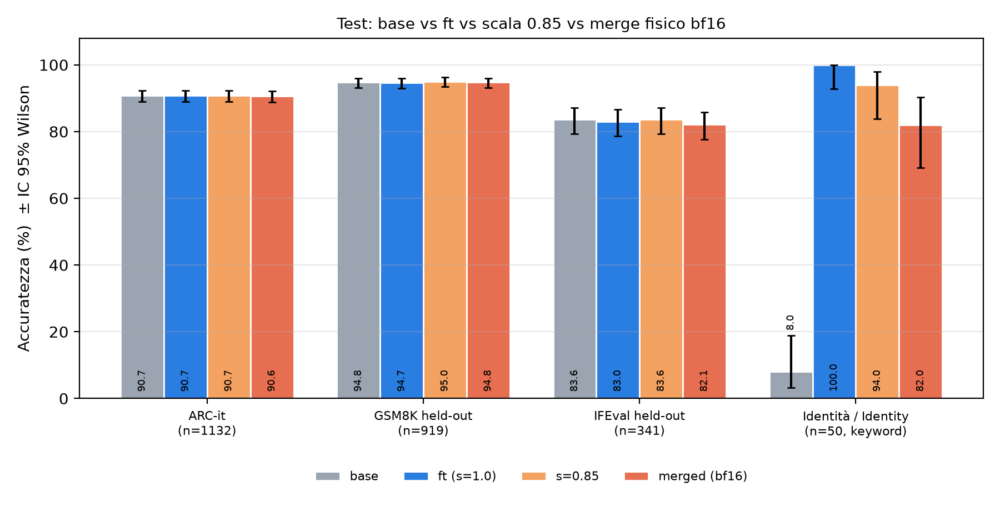

# Qwen3-14B v2 — «Lo Scienziato Dilettante GDP» (adattatore LoRA)

> **Questo repository contiene codice, articoli e risultati, senza pesi.** L'adattatore LoRA è su Hugging Face: <https://huggingface.co/odelpa/qwen14-scienziato-v2> · dati e risultati per-item: <https://huggingface.co/datasets/odelpa/qwen14-scienziato-v2-dati>
> *This repository holds code, papers and results, no weights. The LoRA adapter is on Hugging Face (links above).*

**Giovanni Del Papa — ricercatore indipendente, Italia · Independent researcher, Italy** (progetto *Lo Scienziato Dilettante GDP*, Arianna Labs)

🇮🇹 [Italiano](#italiano) · 🇬🇧 [English](#english) · 📄 Articolo / Paper: [`paper/article_it.pdf`](paper/article_it.pdf) · [`paper/article_en.pdf`](paper/article_en.pdf) · DOI Zenodo: [10.5281/zenodo.23757652](https://doi.org/10.5281/zenodo.23757652) · Divulgativa / plain-language: [`paper/divulgativa_it.pdf`](paper/divulgativa_it.pdf) · [`paper/divulgativa_en.pdf`](paper/divulgativa_en.pdf)

---

## Italiano

### In una frase
Un adattatore LoRA (r = 16, 0,43 % dei parametri) addestrato su **risposte generate dal modello stesso** (auto-distillazione, senza codice, solo dati con licenza commerciale) porta l'identità dichiarata da **8 % a 100 %** *(test a parole chiave, 50 domande)* **senza differenze significative** su ARC-it, GSM8K e IFEval. **L'unico guadagno significativo è l'identità; non c'è alcun miglioramento di capacità.**

| Test (held-out) | n | base | + LoRA (s = 1,0) | differenza [IC 95 %] | p (McNemar) |
|---|---|---|---|---|---|
| ARC-it | 1132 | 90,72 % | 90,72 % | 0 (0 / 0 item) | 1,00 |
| GSM8K | 919 | 94,78 % | 94,67 % | −0,11 [−0,99; +0,77] | 1,00 (8/9) |
| IFEval (prompt-level strict) | 341 | 83,58 % | 83,00 % | −0,59 [−2,58; +1,40] | 0,77 (5/7) |
| Identità (parole chiave) | 50 | 8 % | 100 % | +92 | 2,8·10⁻¹⁴ (46/0) |



### ⚠️ Limiti (leggere prima di usare)
1. **L'identità è misurata a parole chiave/regex** (`code/pod/score.py`), non da un giudice umano o da un modello. Le 4 risposte «corrette» della base (v01, v03, v18, n27) sono falsi positivi (la parola chiave è nella domanda): sulle domande vere la base ottiene 0.
2. **Il 100 % non è correttezza fattuale.** Il modello fine-tuned **inventa dettagli** (CEO, imprenditore, personaggio immaginario, variante «Chimica», significato di *ing-gdp-ai*) e in n03 («Sei ChatGPT?») risponde in inglese. Lo scorer usato per il modello Mistral del progetto era diverso (solo «gdp»/«del papa»).
3. **Nessun miglioramento di capacità**, e la non-regressione è solo una stima puntuale (IC ampi: per IFEval una perdita di ~2,6 punti non è esclusa).
4. **Un solo run, un solo seed, greedy.** Il run r1 (5,69 $) è andato perso per un errore operativo; r2 è costato 4,48 $. Rumore dello scorer IFEval: 0,86 vs 0,865 con generazioni identiche.
5. **Il merge fisico in bf16 perde identità (82 %)** e IFEval −1,5 punti: perciò si pubblica **solo l'adattatore** (nessun peso fuso). Il GGUF per Ollama (§ sotto) non è l'oggetto valutato nell'articolo.
6. Scheda identità scritta a mano; solo modalità non-thinking; nessuna valutazione di sicurezza/codice.

### Come funziona, passo per passo
1. **Dati (blocchi A–D)**: prompt da `aya_dataset` (ITA), `oasst1`, GSM8K-train (MIT), prompt generati da Qwen3-14B e vincoli verificabili in stile IFEval (propri, non i prompt di IFEval). Esclusi: ultrachat, personahub (OpenAI), codealpaca, numinamath-tir, no_robots, wildchat, flan, ecc. (`results/MANIFEST.json`).
2. **Auto-distillazione** (`code/pod/p1_gen.py`): Qwen3-14B (vLLM, bf16, no-thinking, T = 0,7) scrive **le proprie risposte**; la *scheda identità* (`code/pod/identity.py`) è visibile **solo in generazione** e **assente nel training** (context distillation). Filtri: dedup, niente codice, risposta GSM8K verificata, vincoli verificati. Risultato: 8601 sequenze di train + 299 di validazione (4,02 M token).
3. **Addestramento LoRA** (`code/pod/p2_train.py`): r = 16, α = 16, dropout 0,05, 7 proiezioni, 64.225.280 parametri; LR 3·10⁻⁵ coseno, warm-up 3 %, 1 epoca, batch 16, 538 passi, bf16 (niente 4-bit); loss 0,299 → 0,198, val 0,188; A100 80 GB, ≈ 67 min.
4. **Scale di merge** (`code/pod/make_loras.py`): $\Delta W = \tfrac{\alpha}{r} B A$ e $W = W_0 + s\,\Delta W$, con $s\in\{0{,}3;\,0{,}5;\,0{,}7;\,0{,}85;\,1{,}0\}$ realizzata scalando `lora_B`.
5. **Regola pre-registrata R1** (scritta *prima* del run, solo su dev; `code/pod/select_scale.py`): scegliere la scala **più piccola** con identità dev ≥ 95 % (≥ 38/40), GSM8K dev ≥ base − 1 pt e IFEval dev ≥ base − 1 pt. Esito: $s = 1{,}0$. R2 = valutazione sul test una sola volta; R3 = criteri di pubblicazione (la condizione (c) «merge fisico ≈ LoRA servito» **non è soddisfatta** → solo adattatore).
6. **Valutazione** (`code/pod/gen.py`, `score.py`, `final_stats.py`): vLLM 0.32.0 bf16, greedy, seed 1234, template Qwen3 con `enable_thinking=False`; ARC-it via logprob, GSM8K regex (max 512 token), IFEval `lm_eval` prompt-level strict (max 1024), identità a parole chiave (max 256).
7. **Statistica**: IC di Wilson al 95 %, McNemar esatto, IC di Wald appaiato, differenza minima rilevabile ≈ $2{,}8\cdot SE$:

$$\hat p \pm z\,\frac{\sqrt{\hat p(1-\hat p)/n + z^2/4n^2}}{1+z^2/n},\qquad p_{\text{McNemar}}=\min\Big(1,\;2\sum_{i=0}^{\min(b,c)}\binom{b+c}{i}2^{-(b+c)}\Big)$$

8. **Diagnostica bf16** (`code/analysis/bf16_merge_diag.py`): $\|\Delta W\|_F/\|W_0\|_F \approx 0{,}106\,\%$; il 74 % degli elementi non cambia con l'arrotondamento a bf16 (8 bit di mantissa, errore relativo fino a $2^{-8}\approx 0{,}4\,\%$).

### Come riprodurre
```bash
# 1) Pod con GPU 80 GB (A100/H100), dentro il pod:
bash code/pod/setup.sh <max_secondi>        # ambiente, download base (dl.py), dati
bash code/pod/run_all.sh                    # P1 generazione → P2 training → P3 scale+dev+R1 → P4 test+merge+statistiche
# 2) Analisi sul risultato:
# (scarica prima il dataset odelpa/qwen14-scienziato-v2-dati in ./dati: contiene results/, sets/, data/)
python code/analysis/paired_stats.py dati/results        # statistiche appaiate (McNemar, Wald)
python code/analysis/bf16_merge_diag.py <shard_base> <adapter> out.json
python code/analysis/make_figures.py dati figures/   # figure IT/EN (legge dati/results/)
bash code/analysis/build_pdf.sh paper/article_it.md paper/article_it.pdf   # PDF con formule (pandoc + tectonic)
```
Gli script del pod assumono la cartella `/workspace` e il token Hugging Face nell'ambiente (non incluso). Le generazioni per-item sono nel dataset [`odelpa/qwen14-scienziato-v2-dati`](https://huggingface.co/datasets/odelpa/qwen14-scienziato-v2-dati).

### Uso dell'adattatore
```python
from transformers import AutoModelForCausalLM, AutoTokenizer
from peft import PeftModel
tok = AutoTokenizer.from_pretrained("Qwen/Qwen3-14B")
m = AutoModelForCausalLM.from_pretrained("Qwen/Qwen3-14B", torch_dtype="auto", device_map="auto")
m = PeftModel.from_pretrained(m, "odelpa/qwen14-scienziato-v2", subfolder="adapter")   # NON fondere in bf16 (vedi limiti)
msgs = [{"role": "user", "content": "Chi sei?"}]
x = tok.apply_chat_template(msgs, add_generation_prompt=True, enable_thinking=False, return_tensors="pt").to(m.device)
print(tok.decode(m.generate(x, max_new_tokens=200, do_sample=False)[0][x.shape[1]:], skip_special_tokens=True))
```
Con vLLM: `vllm serve Qwen/Qwen3-14B --enable-lora --lora-modules ft=<cartella adapter>` (come nella valutazione).

### Ollama
`ollama run ollamagdp/qwen14-scienziato-v2` — GGUF Q4_K_M del merge fp16 (somma fp32), `code/ollama/`. **Non è l'oggetto valutato nell'articolo**; test fatti: vedi `OLLAMA_README.md`.

### Licenze
Codice e adattatore: Apache-2.0 (base Qwen3-14B: Apache-2.0, © Alibaba Cloud / Qwen team). Testo degli articoli: CC BY 4.0. Dati: licenze commerciali (Apache-2.0, MIT; risposte generate da Qwen3-14B, Apache-2.0), elenco in `results/MANIFEST.json`. Nessun segreto o token è incluso.

---

## English

### In one sentence
A rank-16 LoRA adapter (0.43 % of the parameters) trained on **the model's own answers** (self-distillation, no code, commercially licensed data only) takes the stated identity from **8 % to 100 %** *(keyword test, 50 questions)* **with no significant difference** on ARC-it, GSM8K and IFEval. **The only significant gain is identity; there is no capability improvement.**

| Held-out test | n | base | + LoRA (s = 1.0) | difference [95 % CI] | p (McNemar) |
|---|---|---|---|---|---|
| ARC-it | 1132 | 90.72 % | 90.72 % | 0 (0 / 0 items) | 1.00 |
| GSM8K | 919 | 94.78 % | 94.67 % | −0.11 [−0.99; +0.77] | 1.00 (8/9) |
| IFEval (prompt-level strict) | 341 | 83.58 % | 83.00 % | −0.59 [−2.58; +1.40] | 0.77 (5/7) |
| Identity (keywords) | 50 | 8 % | 100 % | +92 | 2.8·10⁻¹⁴ (46/0) |


### ⚠️ Limitations (read before use)
1. **Identity is scored with keywords/regex** (`code/pod/score.py`), not by a human or a model judge. The 4 "correct" answers of the base (v01, v03, v18, n27) are false positives (the keyword is in the question): on the genuine questions the base scores 0.
2. **100 % is not factual correctness.** The fine-tuned model **invents details** (CEO, entrepreneur, fictional character, a "Chemistry" variant, a meaning for *ing-gdp-ai*) and on n03 ("Are you ChatGPT?") answers in English. The scorer used for the project's Mistral model was different (only "gdp"/"del papa").
3. **No capability improvement**, and non-regression is only a point estimate (wide CIs: a ~2.6-point IFEval loss is not excluded).
4. **One run, one seed, greedy.** Run r1 ($5.69) was lost through an operational error; r2 cost $4.48. IFEval scorer noise: 0.86 vs 0.865 with identical generations.
5. **A physical bf16 merge loses identity (82 %)** and IFEval −1.5 pt: therefore **only the adapter is published** (no merged weights). The Ollama GGUF (below) is not the object evaluated in the paper.
6. Hand-written identity card; non-thinking mode only; no safety/code evaluation.

### How it works, step by step
1. **Data (blocks A–D)**: prompts from `aya_dataset` (ITA), `oasst1`, GSM8K-train (MIT), Qwen3-14B-generated prompts and verifiable IFEval-style constraints (our own, not IFEval prompts). Excluded: ultrachat, personahub (OpenAI), codealpaca, numinamath-tir, no_robots, wildchat, flan, etc. (`results/MANIFEST.json`).
2. **Self-distillation** (`code/pod/p1_gen.py`): Qwen3-14B (vLLM, bf16, no-thinking, T = 0.7) writes **its own answers**; the *identity card* (`code/pod/identity.py`) is visible **only at generation time** and **absent from training** (context distillation). Filters: dedup, no code, verified GSM8K answers, verified constraints. Result: 8,601 train + 299 validation sequences (4.02 M tokens).
3. **LoRA training** (`code/pod/p2_train.py`): r = 16, α = 16, dropout 0.05, 7 projections, 64,225,280 parameters; LR 3·10⁻⁵ cosine, 3 % warm-up, 1 epoch, batch 16, 538 steps, bf16 (no 4-bit); loss 0.299 → 0.198, val 0.188; A100 80 GB, ≈ 67 min.
4. **Merge scales** (`code/pod/make_loras.py`): $\Delta W = \tfrac{\alpha}{r} B A$ and $W = W_0 + s\,\Delta W$ with $s\in\{0.3, 0.5, 0.7, 0.85, 1.0\}$, implemented by scaling `lora_B`.
5. **Pre-registered rule R1** (written *before* the run, dev only; `code/pod/select_scale.py`): choose the **smallest** scale with dev identity ≥ 95 % (≥ 38/40), dev GSM8K ≥ base − 1 pt and dev IFEval ≥ base − 1 pt. Outcome: $s = 1.0$. R2 = test evaluation, once; R3 = publication criteria (condition (c) "physical merge ≈ served LoRA" is **not met** → adapter only).
6. **Evaluation** (`code/pod/gen.py`, `score.py`, `final_stats.py`): vLLM 0.32.0 bf16, greedy, seed 1234, Qwen3 template with `enable_thinking=False`; ARC-it via logprobs, GSM8K regex (max 512 tokens), IFEval `lm_eval` prompt-level strict (max 1024), keyword identity (max 256).
7. **Statistics**: Wilson 95 % CI, exact McNemar, paired Wald CI, minimum detectable difference ≈ $2.8\cdot SE$:

$$\hat p \pm z\,\frac{\sqrt{\hat p(1-\hat p)/n + z^2/4n^2}}{1+z^2/n},\qquad p_{\text{McNemar}}=\min\Big(1,\;2\sum_{i=0}^{\min(b,c)}\binom{b+c}{i}2^{-(b+c)}\Big)$$

8. **bf16 diagnostic** (`code/analysis/bf16_merge_diag.py`): $\|\Delta W\|_F/\|W_0\|_F \approx 0.106\,\%$; 74 % of the elements do not change when rounded to bf16 (8 mantissa bits, relative error up to $2^{-8}\approx 0.4\,\%$).

### How to reproduce
```bash
# 1) GPU pod with 80 GB (A100/H100); inside the pod:
bash code/pod/setup.sh <max_seconds>        # environment, base download (dl.py), data
bash code/pod/run_all.sh                    # P1 generation → P2 training → P3 scales+dev+R1 → P4 test+merge+stats
# 2) Analysis of the results:
# first download the dataset odelpa/qwen14-scienziato-v2-dati into ./dati (it holds results/, sets/, data/)
python code/analysis/paired_stats.py dati/results
python code/analysis/bf16_merge_diag.py <base_shard> <adapter> out.json
python code/analysis/make_figures.py dati figures/
bash code/analysis/build_pdf.sh paper/article_en.md paper/article_en.pdf   # PDF with formulas (pandoc + tectonic)
```
The pod scripts assume the `/workspace` folder and a Hugging Face token in the environment (not included). Per-item generations are in the dataset [`odelpa/qwen14-scienziato-v2-dati`](https://huggingface.co/datasets/odelpa/qwen14-scienziato-v2-dati).

### Using the adapter
See the Python snippet above (`subfolder="adapter"`), or `vllm serve Qwen/Qwen3-14B --enable-lora --lora-modules ft=<adapter folder>`. **Do not merge in bf16** (see limitations).

### Ollama
`ollama run ollamagdp/qwen14-scienziato-v2` — Q4_K_M GGUF of the fp16 merge (fp32 summation), `code/ollama/`. **Not the object evaluated in the paper**; tests done: see `OLLAMA_README.md`.

### Licences
Code and adapter: Apache-2.0 (base Qwen3-14B: Apache-2.0, © Alibaba Cloud / Qwen team). Article text: CC BY 4.0. Data: commercially usable licences (Apache-2.0, MIT; answers generated by Qwen3-14B, Apache-2.0), listed in `results/MANIFEST.json`. No secrets or tokens are included.
