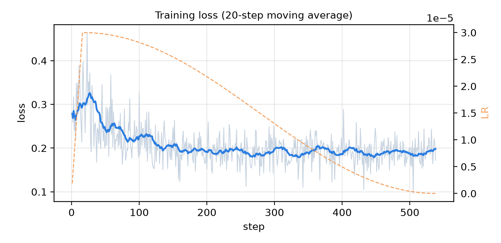
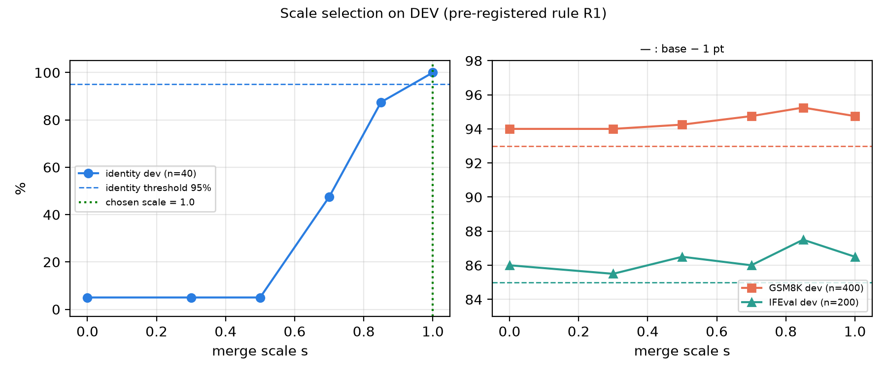

**Cite as:** Del Papa, G. (2026). *Qwen3-14B v2: a gentle self-distillation LoRA gives identity but no extra capability.* Preprint (IT/EN), Zenodo. DOI: [10.5281/zenodo.23757652](https://doi.org/10.5281/zenodo.23757652) (all versions). Text licence: CC BY 4.0. *Versione italiana di questo articolo: stesso record (file `article_it.pdf`).*

# Abstract

We train a rank-16 LoRA adapter (α = 16, learning rate 3·10⁻⁵, a single epoch, 538 steps) on Qwen3-14B in bf16, using only **self-distillation** data: the training answers are generated by the base model itself (about 8.9 k examples, 4.0 M tokens), with no code, commercially licensed prompts, and an identity card ("Arianna Labs", "Lo Scienziato Dilettante GDP") that is hidden at generation time and absent from training. The merge scale $s$ in $W=W_0+s\,\Delta W$ is chosen on a development set by a rule fixed *before* the run (identity ≥ 95 % and no benchmark more than 1 point below the base). The rule selects $s=1.0$. On the held-out test, with greedy decoding in vLLM bf16: ARC-it 90.7 → 90.7 % (n = 1132), GSM8K 94.8 → 94.7 % (n = 919, McNemar p = 1.0), IFEval 83.6 → 83.0 % (n = 341, p = 0.77) and identity 8 → 100 % (n = 50, p < 0.001). **The only significant gain is identity**; there is no capability improvement, and the absence of regression is shown only as a point estimate (the confidence intervals include differences of about −1 and −2.6 points). The identity test is keyword-based, not judged by a person or a model, and the 100 % is **not** evidence of factual correctness: the model sometimes invents details that are not in the identity card. The physical bf16 merge loses part of the identity (82 % instead of 100 %), so we publish the adapter, not merged weights. A first attempt (r1, $5.69) was lost through an operational error; the valid run (r2) cost $4.48.

# 1. Introduction

Light fine-tuning can give an open model a consistent identity and style for a project without degrading its abilities. In the project *Lo Scienziato Dilettante GDP*, two earlier attempts (v1) instead made the models worse: Qwen3-14B v1 (LoRA r = 32, LR $10^{-4}$, 1.5 epochs, 40.7 k mixed examples) dropped GSM8K from 93.3 % to 82 % and IFEval from 83 % to 63 %; Mistral-Small-3.2-24B v1 fell on GSM8K from 95.0 % to 65.4 % (full set, 1319 problems). The plausible causes, **not isolated experimentally**, were: answers from other models in the mix (ultrachat, personahub, evol-codealpaca) that shift the reasoning style; a LoRA that is too strong; little identity data (1.2 % of the mix); and training on a 4-bit quantised base but serving in bf16.

We report the v2 recipe, designed to remove those causes, and evaluate it with a protocol declared in advance. The question is modest: *can Qwen3-14B be given an identity without losing capability?* The answer is yes for identity and "no detectable difference" for capabilities; this is not a more capable model.

**Contributions.** (i) a self-distillation recipe with no code and only commercially licensed data; (ii) a **pre-registered** rule for choosing the merge scale; (iii) paired statistics (exact McNemar, confidence intervals) and minimum detectable effect; (iv) an honest analysis of what does not work (physical merge, identity metric); (v) all code, training data and per-item results released.

# 2. Method

## 2.1 Base model

`Qwen/Qwen3-14B`, revision `40c069824f4251a91eefaf281ebe4c544efd3e18` (Apache-2.0, 14.8 billion parameters), weights in **bf16** (no quantisation during training). We use the *non-thinking* mode: prompts follow the tokenizer's chat template with `enable_thinking=False` (an empty `<think></think>` block). A byte-by-byte check confirmed that the training string equals the evaluation string (0 mismatches on 360 checked examples).

## 2.2 LoRA and merge

For a weight matrix $W_0\in\mathbb{R}^{d_{out}\times d_{in}}$ LoRA adds a low-rank update:

$$
\Delta W=\frac{\alpha}{r}\,B A,\qquad B\in\mathbb{R}^{d_{out}\times r},\; A\in\mathbb{R}^{r\times d_{in}},\qquad h=W_0x+\Delta W\,x .
$$

With $r=16$ and $\alpha=16$ the factor $\alpha/r$ equals 1; $B$ is initialised to zero and $A$ randomly (Kaiming), with dropout 0.05 on the adapter input. Adapters are applied to all seven linear maps of every layer ($q,k,v,o,\text{gate},\text{up},\text{down}$): per layer $\sum r(d_{in}+d_{out}) = 1\,605\,632$, and over 40 layers **64 225 280 trainable parameters (0.433 %)**.

The **merge at scale $s$** is
$$
W(s)=W_0+s\,\Delta W,\qquad s\in\{0.3,\;0.5,\;0.7,\;0.85,\;1.0\},
$$
implemented by multiplying the matrix $B$ by $s$ (exactly equivalent, in floating point, to scaling $\Delta W$). The "ft", "s085", etc. evaluations use the *unmerged* adapter served by vLLM ($W_0x+s\,\Delta Wx$ computed separately); the "merged" variant is instead the **physical merge** $W=\mathrm{bf16}(W_0+\Delta W)$ saved as model weights.

**Optimisation.** Cross-entropy loss on answer tokens only (prompt masked), normalised by the number of target tokens in the batch:
$$
\mathcal{L}=-\frac{1}{N_{tgt}}\sum_{t\in\text{answer}}\log p_\theta(y_t\mid y_{<t}).
$$
AdamW ($\beta=(0.9,0.999)$, weight decay 0), learning rate with 3 % linear warm-up and cosine decay:
$$
\eta_t=\begin{cases}\eta_{max}\,\dfrac{t+1}{w} & t<w\\[2mm] \dfrac{\eta_{max}}{2}\left(1+\cos\dfrac{\pi\,(t-w)}{T-w}\right) & t\ge w\end{cases}\qquad \eta_{max}=3\cdot10^{-5},\; w=\lfloor 0.03\,T\rfloor,\; T=538 .
$$
Effective batch 16 sequences, maximum length 2048, gradient clipping at norm 1.0 (the largest observed norm is 0.23: clipping never triggered), gradient checkpointing, 1 epoch, seed 1234. In total 8601 sequences, 4 020 342 tokens (3 332 048 target), 3 996 s at ≈1006 tokens/s on one A100 SXM 80 GB.

## 2.3 Data: self-distillation, no code, commercial licence

Training answers are generated by **Qwen3-14B itself** (vLLM, bf16, non-thinking, $T=0.7$, top-p 0.8, top-k 20): the model learns style and identity, not a new reasoning distribution. The final mix has 8900 examples (8601 train + 299 validation):

| Block | Content | Prompt source (licence) | Selection |
|---|---|---|---|
| A (3865) | general Italian, no code | aya_dataset ITA and oasst1 (Apache-2.0, human) + prompts generated by Qwen3-14B | drop truncated answers, answers with code, answers that name Qwen/Alibaba as the author |
| B (2416) | mathematics | GSM8K *train* (MIT) | *rejection sampling*: keep only the answer that yields the gold value (3168 kept out of 3300 problems; 2416 in the mix, after format and length filters) |
| C (1160) | verifiable instructions | generated prompts + programmatic constraint in IFEval style | keep only answers that pass the constraint checker (3585 of 4088 attempts, 87.7 %) |
| D (1160) | identity | synthetic IT/EN questions, with/without system prompt, multi-turn, negations | *context distillation*: the identity card (§2.4) is in the system prompt at generation but **absent** from training |

**Excluded:** ultrachat_200k, personahub (OpenAI outputs), codealpaca, numinamath-TIR, no_robots, wildchat, flan, fine-instructions-ita-70k (LLM-translated), everyday-conversations-ita (prompts generated by an external LLM) and **all IFEval prompts**. The training set contains no code (filter on prompts and answers). Every row has its licence and sha256 in `MANIFEST.json`. There is no OpenAI, Anthropic or Google output in the mix. The mean length of the pilot answers was 204 tokens with 0 % truncation.

## 2.4 Identity card (text actually used)

The card used at generation time (`pod/identity.py`, variable `CARD`) says, in short, that the model is called "Qwen3-14B-gdp_it", belongs to the project "Lo Scienziato Dilettante GDP" of Arianna Labs, was fine-tuned (LoRA) by Giovanni Del Papa, nicknamed "gdp", from Alibaba Cloud's Qwen3-14B (Apache-2.0); it is not ChatGPT, GPT-4, Claude, Gemini, Llama, Mistral, etc.; it answers in the user's language; and it must not invent other details about itself. The full text is in the repository. The card is a working hypothesis built from facts in the project's documents. A short form of the identity ("I am the assistant of the Scienziato Dilettante, created by Giovanni Del Papa for Arianna Labs") is used only as a system prompt in the Ollama Modelfile (§6), not in training.

## 2.5 Evaluation

**Sets.** Italian ARC (test, n = 1132); GSM8K (the 1319 problems of the original test split, divided into dev 400, test 150, rest 769); IFEval (541 prompts: dev 200, test 100, rest 241); identity (dev 40, test 50). "*Held-out*" = test + rest (GSM8K 919; IFEval 341), i.e. everything not used to choose the scale. The dev set is used *only* to choose the scale. GSM8K training prompts come only from the official *train* split; IFEval prompts are never used; generated identity questions are dropped if they overlap (token Jaccard ≥ 0.6) with those of ident_dev/ident_test.

**Decoding.** vLLM 0.32.0, bf16, greedy ($T=0$), seed 1234, non-thinking. ARC: the letter with the highest log-probability among the options (1 token); GSM8K: last number after "answer is" (max 512 generated tokens; IFEval max 1024; identity max 256); IFEval: `lm_eval` prompt-level *strict*; identity: **keyword check** (§5). Recorded software: torch 2.13.0+cu132, peft 0.21.2, transformers 5.19.0.

## 2.6 Statistics

For every set of $N$ items, base and variant are evaluated on the *same* items. Let $c$ be the number of items correct only for the variant ("fixed") and $b$ those correct only for the base ("broken").

**Wilson interval (95 %)** for an accuracy $\hat p=k/n$, $z=1.96$:
$$
\frac{\hat p+\frac{z^{2}}{2n}\pm z\sqrt{\frac{\hat p(1-\hat p)}{n}+\frac{z^{2}}{4n^{2}}}}{1+\frac{z^{2}}{n}} .
$$

**Exact McNemar test** (two-sided). With $n=b+c$ discordant pairs and, under $H_0$, $b\sim\mathrm{Bin}(n,\tfrac12)$:
$$
p=\min\Bigl\{1,\;2\sum_{i=0}^{\min(b,c)}\binom{n}{i}2^{-n}\Bigr\}.
$$

**Paired difference** $\hat\Delta=(c-b)/N$ with standard error and Wald interval
$$
\widehat{SE}=\frac{\sqrt{\,b+c-(c-b)^{2}/N\,}}{N},\qquad \hat\Delta\pm1.96\,\widehat{SE}.
$$
(For identity, where $\hat p=1$, we report the Wilson interval of the accuracy, because Wald leaves $[0,100]$.)

**Power.** The minimum detectable difference at $\alpha=0.05$ and 80 % power is about $(z_{0.975}+z_{0.80})\,\widehat{SE}\approx 2.8\,\widehat{SE}$.

## 2.7 Pre-registered selection rule

The plan (`PLAN.md`, 28 Oct 2026, 21:00–21:10 Rome time, before launch) fixed:

- **R1 (dev only).** A scale $s$ *qualifies* if $I_s\ge 0.95$ (≥ 38/40 on identity dev), $G_s\ge G_0-0.01$ (GSM8K dev, 400) and $F_s\ge F_0-0.01$ (IFEval dev, 200, prompt-level strict), where $G_0,F_0$ are the base values. The **smallest** qualifying scale is chosen: $s^\star=\min\{s: I_s\ge0.95\wedge G_s\ge G_0-0.01\wedge F_s\ge F_0-0.01\}$. If none qualifies: no merge and no publication.
- **R2.** A clean final evaluation of base, ft, chosen scale, a neighbouring scale and the physical merge, with McNemar and intervals.
- **R3 (publish only if)**: (a) identity test ≥ 95 %; (b) ARC-it, GSM8K and IFEval held-out ≥ base − 1 point; (c) physical merge ≈ served LoRA within ±0.5 points; (d) clean data licensing; (e) explicit OK from Giovanni.

The plan stated that, by construction, *parity* on capabilities is expected, not improvement.

# 3. Results

## 3.1 Training

The mean loss goes from 0.299 (first 20 steps) to 0.198 (last 20); validation loss 0.188 on 299 sequences. No instability.

{width=75%}

## 3.2 Scale selection on dev (R1)

| Scale $s$ | Identity dev (/40) | GSM8K dev | IFEval dev | Qualifies |
|---|---|---|---|---|
| base (0) | 5.0 % | 94.0 % | 86.0 %\* | – |
| 0.3 | 5.0 % | 94.0 % | 85.5 % | no (identity) |
| 0.5 | 5.0 % | 94.25 % | 86.5 % | no (identity) |
| 0.7 | 47.5 % | 94.75 % | 86.0 % | no (identity) |
| 0.85 | 87.5 % | 95.25 % | 87.5 % | no (identity) |
| **1.0** | **100 %** | 94.75 % | 86.5 % | **yes → chosen** |

\* The base on IFEval dev is 86.0 % in the P3 scoring and 86.5 % in the final re-scoring **of the same outputs**: the IFEval checker is not perfectly deterministic (±1 prompt out of 200). The decision does not change ($s=1.0$ qualifies on identity with either value).

Identity appears non-linearly: nothing up to $s=0.5$ (as for the base), 47.5 % at 0.7, 87.5 % at 0.85, 100 % at 1.0. Capabilities stay within noise at every scale. Since no smaller scale qualifies, the rule selects $s^\star=1.0$, i.e. the full adapter (no "reduced-scale merge").

## 3.3 Held-out test (R2)

| Set | n | base | ft ($s=1$) | $\Delta$ (95 % CI) | fixed/broken | McNemar $p$ |
|---|---|---|---|---|---|---|
| ARC-it | 1132 | 90.72 % [88.9; 92.3] | 90.72 % | 0.00 [0.00; 0.00] | 0/0 | 1.00 |
| GSM8K held-out | 919 | 94.78 % [93.1; 96.0] | 94.67 % | −0.11 [−0.99; +0.77] | 8/9 | 1.00 |
| IFEval held-out | 341 | 83.58 % [79.3; 87.1] | 83.00 % | −0.59 [−2.58; +1.40] | 5/7 | 0.77 |
| Identity (keywords) | 50 | 8.0 % [3.2; 18.8] | 100 % [92.9; 100] | +92.0 | 46/0 | $2.8\cdot10^{-14}$ |

Additional variants (same test; none was chosen after seeing it):

| Set | base | s = 0.85 (unmerged) | merged (physical bf16 merge, $s=1$) |
|---|---|---|---|
| ARC-it | 90.7 % | 90.7 % (0/0, $p=1$) | 90.6 % (0/1, $p=1$) |
| GSM8K held-out | 94.8 % | 95.0 % (9/7, $p=0.80$) | 94.8 % (7/7, $p=1$) |
| IFEval held-out | 83.6 % | 83.6 % (8/8, $p=1$) | 82.1 % (8/13, $p=0.38$; Δ −1.5 [−4.1; +1.2]) |
| Identity | 8 % | 94 % | **82 %** |

On the full sets (including dev): GSM8K 94.5 → 94.7 % (p = 0.85); IFEval 84.7 → 84.3 % (p = 0.83).

**Reading.** On ARC-it the base and ft predictions are *identical* on all 1132 items (0 fixed, 0 broken): the test is very insensitive (a single letter, log-probability). On GSM8K and IFEval the differences are within noise: with $b+c=17$ discordant pairs out of 919 the minimum detectable difference is ≈ 1.3 points; with $b+c=12$ out of 341 it is ≈ 2.8 points. Rule R3(b) ("no more than 1 point below") is therefore satisfied **as a point estimate** (−0.11 and −0.59), but the lower interval limits (−0.99 and −2.58) do not allow us to exclude a small regression on IFEval.

## 3.4 Verdict on rule R3

| Condition | Outcome |
|---|---|
| (a) identity ≥ 95 % | ✓ 100 % (keyword; see §5) |
| (b) capabilities ≥ base − 1 pt | ✓ for ft and s = 0.85 as point estimates (0.0; −0.11; −0.59); not shown statistically. For the physical merge IFEval is −1.5 pt (✗) |
| (c) physical merge ≈ served LoRA (±0.5 pt) | **✗** identity 82 % vs 100 %; IFEval 82.1 vs 83.0 |
| (d) clean data licensing | ✓ (§2.3) |
| (e) OK from Giovanni | ✓ 29 Oct 2026, 08:17 (Rome) |

Condition (c) is **not met**: the object evaluated and recommended is therefore the **unmerged LoRA adapter**, which we publish; the bf16 merged weights are *not* published because they do not reproduce the evaluated behaviour.

## 3.5 Why the physical bf16 merge loses identity (post-hoc diagnostic)

bf16 has 8 significant bits: the relative rounding of every weight can reach $2^{-8}\approx0.4\,\%$. If $|\Delta W_{ij}|$ is much smaller than $|W_{0,ij}|\,2^{-8}$, the addition $W_0+\Delta W$ is rounded to $W_0$ and the correction is lost. With LR $3\cdot10^{-5}$ and a single epoch, $\Delta W$ is small. We measured (script `bf16_merge_diag.py`, **post-hoc analysis, not pre-registered**) on 68 matrices of the first layers: mean ratio $\|\Delta W\|_F/\|W_0\|_F=$ 0.106 %; mean relative error of the delta after rounding $\|\Delta W_{eff}-\Delta W\|_F/\|\Delta W\|_F=$ 0.73; mean fraction of elements for which the merge **changes nothing at all**: 74 %; mean cosine between $\Delta W_{eff}$ and $\Delta W$: 0.70. In other words $\Delta W$ is about 0.1 % of $W_0$: after rounding to bf16 about three weight elements out of four are not changed at all and the effective delta has a relative error of about 70 %, with cosine ≈ 0.7 with respect to the intended one (measured on matrices from the first and the fifth weight shard: layers 0–3 and a middle block). An fp16 merge (11 mantissa bits) loses far less (a hypothesis, only indirectly supported: the Q4_K_M GGUF built from the fp16 merge scores 50/50 on the same keyword identity test, see `OLLAMA_README.md`); this is why the GGUF for Ollama (§6) is built with fp32 summation and fp16 storage. This is a plausible explanation consistent with the data, but it was not verified with a higher-precision merge *and* a new evaluation.

# 4. Discussion

**What is shown.** A gentle LoRA trained on the model's own answers, without code, takes the stated identity from 8 % to 100 % (by our keyword check) with no significant differences on ARC-it, GSM8K and IFEval (point estimates within 0.6 points). Compared with the v1 attempts (−11 points on GSM8K, −20 on IFEval) the capability regression disappears; our interpretation (other models' data, an overly strong LoRA, 4-bit training) is consistent but **was not isolated** with ablations.

**What is not shown.** There is no capability improvement: all capability differences are compatible with zero. We do not show the absence of regression on other tasks (code, long context, *thinking* reasoning, safety), which were not measured.

# 5. Limitations (honest)

1. **The only significant gain is identity; there is no capability improvement.** The model is "like the base, but knows who it is".
2. **The identity test is keyword-based, not judged.** The score (`pod/score.py`) counts an answer as correct if it contains at least one of "arianna labs", "gdp", "del papa", "scienziato dilettante" and does not name ChatGPT/OpenAI/Claude/Anthropic/Gemini/Llama/Meta AI/Mistral without a negation ("non sono", "not", "n't", "né"). The 4 "correct" answers of the *base* (v01, v03, v18, n27) are **false positives**: the keyword is in the question ("Who is Giovanni Del Papa to you?", "What is ing-gdp-ai?") and the base answers that it does not know, or that it is a "fictional character". On the 46 real identity questions the base scores 0. The scorer used for the Mistral model in the project was slightly different (only "gdp"/"del papa"), so the numbers are not comparable.
3. **100 % is not factual correctness.** The fine-tuned model sometimes **invents details that are not in the card**: e.g. "CEO", "Italian entrepreneur", "fictional character created by Giovanni Del Papa", a reference to a "Chemistry" variant, a meaning for "ing-gdp-ai". On n03 ("Are you ChatGPT?", in Italian) it answers in English to an Italian question. The test is small (n = 50) and its questions share phrasing families with training block D. There was no systematic human review.
4. **Non-regression only as a point estimate.** For IFEval the interval of the difference runs from −2.6 to +1.4 points; with n = 341 a small loss cannot be excluded (minimum detectable ≈ 2.8 points).
5. **One run, one seed, greedy.** No replication; seed-to-seed variability is unknown. The IFEval checker has a small non-determinism (§3.2).
6. **Format overlap.** Block B uses the GSM8K (train) "The answer is N" format and block C the same *families of constraints* as IFEval (not its prompts): any benefit on these benchmarks would not be "general capability". In any case we observe no benefit.
7. **ARC-it is uninformative**: identical predictions on every item.
8. **Noisy dev selection** (identity dev n = 40: one item = 2.5 points; IFEval dev ±3 points). The rule, dominated by the identity criterion, chose $s=1.0$ unambiguously, but the curve between 0.5 and 0.85 rests on few items.
9. **The physical merge does not reproduce the adapter** (§3.4). Any conversion (merge, GGUF, Q4 quantisation) is a different object from the one evaluated and must be re-evaluated: the Ollama build (§6) is not part of this article's results.
10. **Hand-written identity card**, partly a working hypothesis; it reflects no verified facts beyond the project's documents.
11. **Cost and a lost run.** A first attempt (r1, 3.18 h, **$5.69**) was lost because the pod deleted itself on a timer before the artefacts were downloaded (an operational, not scientific, error); we have no r1 results. Run r2 (2.56 h, A100 80 GB at $1.79/h) cost **$4.48** (balance drop; guard estimate $4.57). Total spent on this model: ≈ $10.2.
12. **Non-thinking mode only** and only three benchmarks; no safety or code evaluation.

# 6. Availability and reproducibility

- **LoRA adapter, code, data and per-item results:** Hugging Face [`odelpa/qwen14-scienziato-v2`](https://huggingface.co/odelpa/qwen14-scienziato-v2) and dataset [`odelpa/qwen14-scienziato-v2-dati`](https://huggingface.co/datasets/odelpa/qwen14-scienziato-v2-dati).
- **Code and articles (no weights):** GitHub [`usergdp136/qwen14-scienziato-v2`](https://github.com/usergdp136/qwen14-scienziato-v2).
- **Ollama:** [`ollamagdp/qwen14-scienziato-v2`](https://ollama.com/ollamagdp/qwen14-scienziato-v2) (Q4_K_M GGUF with Modelfile; see the README for tests and limits: it is not the evaluated object).
- **Licences.** Code and adapter: Apache-2.0 (base Qwen3-14B: Apache-2.0, attribution and modifications noted in the repository). Article text: CC BY 4.0. Training data: licences listed in the manifest (Apache-2.0, MIT; answers generated by Qwen3-14B, Apache-2.0).

# References

- Hu, E. J. et al. (2021). *LoRA: Low-Rank Adaptation of Large Language Models.* arXiv:2106.09685.
- Yang, A. et al. (2025). *Qwen3 Technical Report.* arXiv:2505.09388.
- Cobbe, K. et al. (2021). *Training Verifiers to Solve Math Word Problems* (GSM8K). arXiv:2110.14168.
- Zhou, J. et al. (2023). *Instruction-Following Evaluation for Large Language Models* (IFEval). arXiv:2311.07911.
- Clark, P. et al. (2018). *Think you have Solved Question Answering? Try ARC.* arXiv:1803.05457.
- Kwon, W. et al. (2023). *Efficient Memory Management for LLM Serving with PagedAttention* (vLLM). arXiv:2309.06180.
- Loshchilov, I., Hutter, F. (2019). *Decoupled Weight Decay Regularization* (AdamW). arXiv:1711.05101.
- Askell, A. et al. (2021). *A General Language Assistant as a Laboratory for Alignment* (context distillation). arXiv:2112.00861.
- Köpf, A. et al. (2023). *OpenAssistant Conversations* (oasst1). arXiv:2304.07327. — Singh, S. et al. (2024). *Aya Dataset.* arXiv:2402.06619.
- McNemar, Q. (1947). *Note on the sampling error of the difference between correlated proportions or percentages.* Psychometrika 12, 153–157.
- Wilson, E. B. (1927). *Probable inference, the law of succession, and statistical inference.* JASA 22, 209–212.
