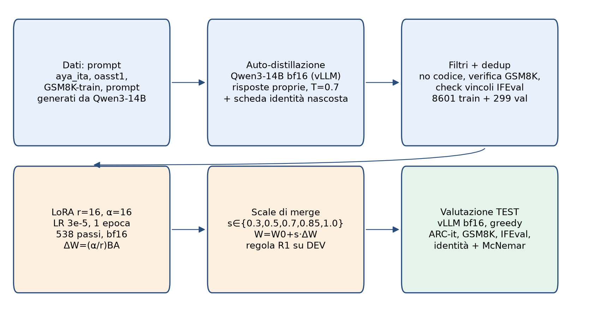
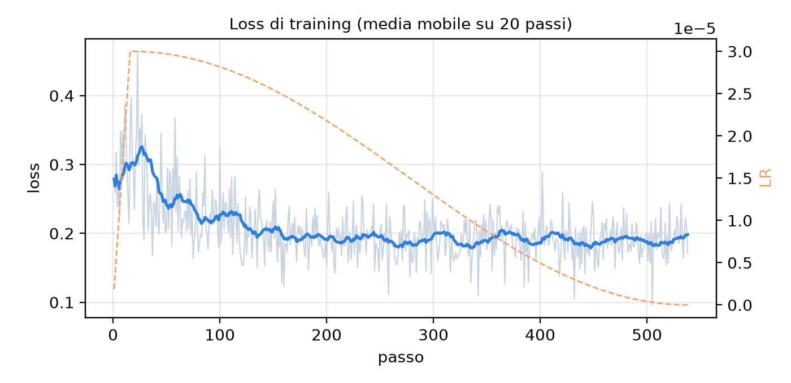
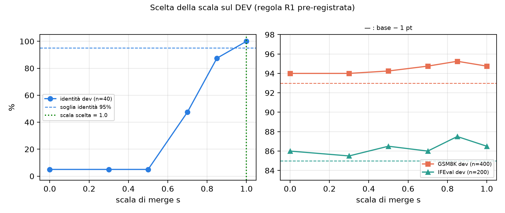

**Citazione:** Del Papa, G. (2026). *Qwen3-14B v2: un LoRA gentile per auto-distillazione dà identità ma nessuna capacità in più.* Preprint (IT/EN), Zenodo. DOI: [10.5281/zenodo.23757652](https://doi.org/10.5281/zenodo.23757652) (tutte le versioni). Licenza del testo: CC BY 4.0. *English version of this article: same record (file `article_en.pdf`).*

# Sommario

Addestriamo un adattatore LoRA di rango 16 (α = 16, learning rate 3·10⁻⁵, una sola epoca, 538 passi) su Qwen3-14B in bf16, usando soltanto dati di **auto-distillazione**: le risposte di training sono generate dal modello base stesso (circa 8,9 mila esempi, 4,0 M token), senza codice, con prompt e risposte a licenza commerciale e con una scheda di identità («Arianna Labs», «Lo Scienziato Dilettante GDP») nascosta in fase di generazione e assente nel training. La scala $s$ del merge $W=W_0+s\,\Delta W$ è scelta su un insieme di sviluppo con una regola fissata *prima* del lancio (identità ≥ 95 % e nessun benchmark oltre 1 punto sotto il base). La regola seleziona $s=1{,}0$. Sul test held-out, con greedy decoding in vLLM bf16: ARC-it 90,7 → 90,7 % (n = 1132), GSM8K 94,8 → 94,7 % (n = 919, McNemar p = 1,0), IFEval 83,6 → 83,0 % (n = 341, p = 0,77) e identità 8 → 100 % (n = 50, p < 0,001). **L'unico guadagno significativo è l'identità**; per le capacità non c'è alcun miglioramento e l'assenza di regressione è dimostrata solo come stima puntuale (gli intervalli di confidenza includono differenze di circa −1 e −2,6 punti). Il test d'identità è basato su parole chiave, non su un giudice, e il 100 % **non** è una prova di correttezza fattuale: il modello inventa a volte dettagli non presenti nella scheda. Il merge fisico in bf16 perde parte dell'identità (82 % invece di 100 %): per questo si pubblica l'adattatore e non i pesi fusi. Un primo tentativo (r1, 5,69 $) è andato perso per un errore operativo; il run valido (r2) è costato 4,48 $.

# 1. Introduzione

Un fine-tuning leggero può servire a dare a un modello aperto un'identità e uno stile coerenti con un progetto, senza degradarne le capacità. Nel progetto *Lo Scienziato Dilettante GDP* due tentativi precedenti (v1) hanno invece peggiorato i modelli: Qwen3-14B v1 (LoRA r = 32, LR $10^{-4}$, 1,5 epoche, 40,7 mila esempi misti) ha portato GSM8K da 93,3 % a 82 % e IFEval da 83 % a 63 %; Mistral-Small-3.2-24B v1 è sceso su GSM8K da 95,0 % a 65,4 % (set completo, 1319 problemi). Le cause plausibili, **non isolate sperimentalmente**, erano: risposte di altri modelli nel mix (ultrachat, personahub, evol-codealpaca) che spostano lo stile di ragionamento; un LoRA troppo forte; poca identità (1,2 % dei dati); training su base quantizzata a 4 bit e uso in bf16.

Qui riportiamo la ricetta v2, ideata per rimuovere queste cause, e la valutiamo con un protocollo dichiarato in anticipo. La domanda è modesta: *si può dare identità a Qwen3-14B senza perdere capacità?* La risposta è sì per l'identità e «nessuna differenza rilevabile» per le capacità; non si tratta di un modello più capace.

**Contributi.** (i) una ricetta di auto-distillazione senza codice e con soli dati a licenza commerciale; (ii) una regola di selezione della scala del merge **pre-registrata**; (iii) statistiche appaiate (McNemar esatto, intervalli di confidenza) e potenza minima rilevabile; (iv) un'analisi onesta di ciò che non funziona (merge fisico, metrica d'identità); (v) tutto il codice, i dati di training e i risultati per-item pubblicati.

# 2. Metodo

## 2.1 Modello base

`Qwen/Qwen3-14B`, revisione `40c069824f4251a91eefaf281ebe4c544efd3e18` (Apache-2.0, 14,8 miliardi di parametri), pesi in **bf16** (nessuna quantizzazione in training). Si usa la modalità *non-thinking*: il prompt segue il template del tokenizer con `enable_thinking=False` (blocco `<think></think>` vuoto). Una verifica byte-per-byte ha confermato che la stringa di training coincide con quella di valutazione (0 differenze su 360 esempi controllati).

## 2.2 LoRA e merge

Per una matrice di pesi $W_0\in\mathbb{R}^{d_{out}\times d_{in}}$ il LoRA aggiunge un aggiornamento a rango basso:

$$
\Delta W=\frac{\alpha}{r}\,B A,\qquad B\in\mathbb{R}^{d_{out}\times r},\; A\in\mathbb{R}^{r\times d_{in}},\qquad h=W_0x+\Delta W\,x .
$$

Con $r=16$ e $\alpha=16$ il fattore $\alpha/r$ vale 1; $B$ è inizializzata a zero, $A$ in modo casuale (Kaiming), dropout 0,05 sull'ingresso dell'adattatore. Gli adattatori sono applicati a tutti e sette i lineari di ogni strato ($q,k,v,o,\text{gate},\text{up},\text{down}$): per uno strato $\sum r(d_{in}+d_{out}) = 1\,605\,632$, e su 40 strati **64 225 280 parametri addestrabili (0,433 %)**.

Il **merge a scala $s$** è
$$
W(s)=W_0+s\,\Delta W,\qquad s\in\{0{,}3;\,0{,}5;\,0{,}7;\,0{,}85;\,1{,}0\},
$$
realizzato moltiplicando per $s$ la matrice $B$ (equivalente esatto, in virgola mobile, a scalare $\Delta W$). Le valutazioni «ft», «s085» ecc. usano l'adattatore *non fuso* servito da vLLM ($W_0x+s\,\Delta Wx$ calcolato separatamente); la variante «merged» è invece il **merge fisico** $W=\mathrm{bf16}(W_0+\Delta W)$ salvato come pesi del modello.

**Ottimizzazione.** Loss di cross-entropia solo sui token di risposta (prompt mascherato), normalizzata per il numero di token bersaglio del batch:
$$
\mathcal{L}=-\frac{1}{N_{tgt}}\sum_{t\in\text{risposta}}\log p_\theta(y_t\mid y_{<t}).
$$
AdamW ($\beta=(0{,}9;0{,}999)$, weight decay 0), learning rate con warm-up lineare del 3 % e coseno:
$$
\eta_t=\begin{cases}\eta_{max}\,\dfrac{t+1}{w} & t<w\\[2mm] \dfrac{\eta_{max}}{2}\left(1+\cos\dfrac{\pi\,(t-w)}{T-w}\right) & t\ge w\end{cases}\qquad \eta_{max}=3\cdot10^{-5},\; w=\lfloor 0{,}03\,T\rfloor,\; T=538 .
$$
Batch effettivo 16 sequenze, lunghezza massima 2048, gradient clipping a norma 1,0 (la norma massima osservata è 0,23: il clipping non è mai intervenuto), gradient checkpointing, 1 epoca, seed 1234. In totale 8601 sequenze, 4 020 342 token (3 332 048 bersaglio), 3 996 s a ≈1006 token/s su una A100 SXM 80 GB.

## 2.3 Dati: auto-distillazione, senza codice, licenza commerciale

Le risposte di training sono generate da **Qwen3-14B stesso** (vLLM, bf16, non-thinking, $T=0{,}7$, top-p 0,8, top-k 20): il modello impara stile e identità, non una nuova distribuzione di ragionamento. Il mix finale è di 8900 esempi (8601 train + 299 validazione):

| Blocco | Contenuto | Fonte dei prompt (licenza) | Selezione |
|---|---|---|---|
| A (3865) | italiano generale, senza codice | aya_dataset ITA e oasst1 (Apache-2.0, umani) + prompt generati da Qwen3-14B | scarto di troncati, di risposte con codice, di risposte che si dichiarano «Qwen/Alibaba» come autore |
| B (2416) | matematica | GSM8K *train* (MIT) | *rejection sampling*: si tiene solo la risposta che dà il valore gold (3168 tenute su 3300 problemi; 2416 nel mix, dopo i filtri sul formato e sulla lunghezza) |
| C (1160) | istruzioni verificabili | prompt generati + vincolo programmatico in stile IFEval | si tengono solo le risposte che superano il controllore del vincolo (3585 su 4088 tentativi, 87,7 %) |
| D (1160) | identità | domande sintetiche IT/EN, con/senza system prompt, multi-turno, negazioni | *context distillation*: la scheda identità (§2.4) è nel system prompt in generazione ma **assente** nel training |

**Esclusi:** ultrachat_200k, personahub (output OpenAI), codealpaca, numinamath-TIR, no_robots, wildchat, flan, fine-instructions-ita-70k (tradotto da un LLM), everyday-conversations-ita (prompt generati da un LLM esterno) e **tutti i prompt di IFEval**. Il training non contiene codice (filtro su prompt e risposte). Ogni riga ha in `MANIFEST.json` licenza e sha256. Non c'è alcun output di OpenAI, Anthropic o Google nel mix. La media delle risposte A è di 204 token con 0 % di troncamenti.

## 2.4 Scheda d'identità (testo realmente usato)

La scheda usata in generazione (`pod/identity.py`, variabile `CARD`) dice, in sintesi, che il modello si chiama «Qwen3-14B-gdp_it», fa parte del progetto «Lo Scienziato Dilettante GDP» di Arianna Labs, è stato messo a punto (LoRA) da Giovanni Del Papa, detto «gdp», a partire da Qwen3-14B di Alibaba Cloud (Apache-2.0); non è ChatGPT, GPT-4, Claude, Gemini, Llama, Mistral ecc.; risponde nella lingua dell'utente; non deve inventare altri dettagli su di sé. Il testo integrale è nel repository. La scheda è un'ipotesi di lavoro costruita da fatti presenti nei documenti del progetto. Una forma breve dell'identità («Sono l'assistente dello Scienziato Dilettante, creato da Giovanni Del Papa per Arianna Labs») è usata solo come system prompt nel Modelfile Ollama (§6), non nel training.

## 2.5 Valutazione

**Set.** ARC italiano (test, n = 1132); GSM8K (1319 problemi del test originale, divisi in dev 400, test 150, rest 769); IFEval (541 prompt: dev 200, test 100, rest 241); identità (dev 40, test 50). «*Held-out*» = test + rest (GSM8K 919; IFEval 341), cioè tutto ciò che non è stato usato per scegliere la scala. Il dev serve *solo* a scegliere la scala. I prompt di GSM8K nel training provengono solo dallo split *train* ufficiale; i prompt di IFEval non sono mai usati; le domande d'identità generate sono scartate se hanno sovrapposizione di token (Jaccard ≥ 0,6) con quelle di ident_dev/ident_test.

**Decodifica.** vLLM 0.32.0, bf16, greedy ($T=0$), seed 1234, non-thinking. ARC: lettera con log-probabilità massima tra le opzioni (1 token); GSM8K: ultimo numero dopo «answer is» (max 512 token generati; IFEval max 1024; identità max 256); IFEval: `lm_eval` prompt-level *strict*; identità: **controllo a parole chiave** (§5). Software registrato: torch 2.13.0+cu132, peft 0.21.2, transformers 5.19.0.

## 2.6 Statistica

Per ogni insieme di $N$ item, base e variante sono valutate sugli *stessi* item. Sia $c$ il numero di item corretti solo nella variante («fixed») e $b$ quelli corretti solo nel base («broken»).

**Intervallo di Wilson (95 %)** per una accuratezza $\hat p=k/n$, $z=1{,}96$:
$$
\frac{\hat p+\frac{z^{2}}{2n}\pm z\sqrt{\frac{\hat p(1-\hat p)}{n}+\frac{z^{2}}{4n^{2}}}}{1+\frac{z^{2}}{n}} .
$$

**Test di McNemar esatto** (bilaterale). Con $n=b+c$ coppie discordanti e, sotto $H_0$, $b\sim\mathrm{Bin}(n,\tfrac12)$:
$$
p=\min\Bigl\{1,\;2\sum_{i=0}^{\min(b,c)}\binom{n}{i}2^{-n}\Bigr\}.
$$

**Differenza appaiata** $\hat\Delta=(c-b)/N$ con errore standard e intervallo di Wald
$$
\widehat{SE}=\frac{\sqrt{\,b+c-(c-b)^{2}/N\,}}{N},\qquad \hat\Delta\pm1{,}96\,\widehat{SE}.
$$
(Per l'identità, dove $\hat p=1$, si usa l'intervallo di Wilson dell'accuratezza, perché Wald esce da $[0,100]$.)

**Potenza.** La differenza minima rilevabile con $\alpha=0{,}05$ e potenza 80 % è circa $(z_{0,975}+z_{0,80})\,\widehat{SE}\approx 2{,}8\,\widehat{SE}$.

## 2.7 Regola di selezione pre-registrata

Il piano (`PLAN.md`, 28/10/2026, ore 21:00–21:10 Roma, prima del lancio) fissava:

- **R1 (solo dev).** La scala $s$ *qualifica* se $I_s\ge 0{,}95$ (≥ 38/40 sull'identità dev), $G_s\ge G_0-0{,}01$ (GSM8K dev, 400) e $F_s\ge F_0-0{,}01$ (IFEval dev, 200, prompt-level strict), dove $G_0,F_0$ sono i valori del base. Si sceglie la **più piccola** scala che qualifica: $s^\star=\min\{s: I_s\ge0{,}95\wedge G_s\ge G_0-0{,}01\wedge F_s\ge F_0-0{,}01\}$. Se nessuna qualifica, nessun merge e nessuna pubblicazione.
- **R2.** Valutazione finale pulita su base, ft, scala scelta, scala vicina, merge fisico, con McNemar e intervalli.
- **R3 (pubblicare solo se)**: (a) identità test ≥ 95 %; (b) ARC-it, GSM8K e IFEval held-out ≥ base − 1 punto; (c) merge fisico ≈ servizio LoRA entro ±0,5 punti; (d) licenza dati pulita; (e) OK esplicito di Giovanni.

Nel piano era dichiarato che, per costruzione, ci si aspetta *parità* sulle capacità e non miglioramenti.

# 3. Risultati

## 3.1 Training

La loss media passa da 0,299 (primi 20 passi) a 0,198 (ultimi 20); loss di validazione 0,188 su 299 sequenze. Il training non ha avuto instabilità.

{width=75%}

## 3.2 Scelta della scala sul dev (R1)

| Scala $s$ | Identità dev (/40) | GSM8K dev | IFEval dev | Qualifica |
|---|---|---|---|---|
| base (0) | 5,0 % | 94,0 % | 86,0 %\* | – |
| 0,3 | 5,0 % | 94,0 % | 85,5 % | no (identità) |
| 0,5 | 5,0 % | 94,25 % | 86,5 % | no (identità) |
| 0,7 | 47,5 % | 94,75 % | 86,0 % | no (identità) |
| 0,85 | 87,5 % | 95,25 % | 87,5 % | no (identità) |
| **1,0** | **100 %** | 94,75 % | 86,5 % | **sì → scelta** |

\* Il base su IFEval dev vale 86,0 % nel punteggio della fase P3 e 86,5 % nel ripunteggio finale **sugli stessi output**: il controllore IFEval non è perfettamente deterministico (±1 prompt su 200). La decisione non cambia (il $s=1{,}0$ qualifica per identità con entrambi i valori).

L'identità compare in modo non lineare: nulla fino a $s=0{,}5$ (come il base), 47,5 % a 0,7, 87,5 % a 0,85, 100 % a 1,0. Le capacità restano entro il rumore a ogni scala. Poiché nessuna scala minore qualifica, la regola seleziona $s^\star=1{,}0$, cioè l'adattatore pieno (nessun "merge a scala ridotta").

## 3.3 Test held-out (R2)

| Insieme | n | base | ft ($s=1$) | $\Delta$ (IC 95 %) | fixed/broken | McNemar $p$ |
|---|---|---|---|---|---|---|
| ARC-it | 1132 | 90,72 % [88,9; 92,3] | 90,72 % | 0,00 [0,00; 0,00] | 0/0 | 1,00 |
| GSM8K held-out | 919 | 94,78 % [93,1; 96,0] | 94,67 % | −0,11 [−0,99; +0,77] | 8/9 | 1,00 |
| IFEval held-out | 341 | 83,58 % [79,3; 87,1] | 83,00 % | −0,59 [−2,58; +1,40] | 5/7 | 0,77 |
| Identità (parole chiave) | 50 | 8,0 % [3,2; 18,8] | 100 % [92,9; 100] | +92,0 | 46/0 | $2{,}8\cdot10^{-14}$ |

Varianti aggiuntive (stesso test, nessuna è stata scelta dopo averlo visto):

| Insieme | base | s = 0,85 (non fuso) | merged (merge fisico bf16, $s=1$) |
|---|---|---|---|
| ARC-it | 90,7 % | 90,7 % (0/0, $p=1$) | 90,6 % (0/1, $p=1$) |
| GSM8K held-out | 94,8 % | 95,0 % (9/7, $p=0{,}80$) | 94,8 % (7/7, $p=1$) |
| IFEval held-out | 83,6 % | 83,6 % (8/8, $p=1$) | 82,1 % (8/13, $p=0{,}38$; Δ −1,5 [−4,1; +1,2]) |
| Identità | 8 % | 94 % | **82 %** |

Sui set completi (inclusi i dev): GSM8K 94,5 → 94,7 % (p = 0,85); IFEval 84,7 → 84,3 % (p = 0,83).

**Lettura.** Su ARC-it le predizioni di base e ft sono *identiche* su tutti i 1132 item (0 fixed, 0 broken): il test è molto poco sensibile (una sola lettera, log-probabilità). Su GSM8K e IFEval le differenze sono dentro il rumore: con $b+c=17$ coppie discordanti su 919 la differenza minima rilevabile è ≈ 1,3 punti; con $b+c=12$ su 341 è ≈ 2,8 punti. La regola R3(b) («non più di 1 punto sotto») è quindi soddisfatta **come stima puntuale** (−0,11 e −0,59), ma i limiti inferiori degli intervalli (−0,99 e −2,58) non permettono di escludere una piccola regressione su IFEval.

## 3.4 Verdetto sulla regola R3

| Condizione | Esito |
|---|---|
| (a) identità ≥ 95 % | ✓ 100 % (keyword; vedi §5) |
| (b) capacità ≥ base − 1 pt | ✓ per ft e s=0,85 come stime puntuali (0,0; −0,11; −0,59); non dimostrata statisticamente. Per il merge fisico IFEval è −1,5 pt (✗) |
| (c) merge fisico ≈ LoRA servito (±0,5 pt) | **✗** identità 82 % vs 100 %; IFEval 82,1 vs 83,0 |
| (d) licenza dati pulita | ✓ (§2.3) |
| (e) OK di Giovanni | ✓ 29/10/2026, 08:17 (Roma) |

La condizione (c) **non è soddisfatta**: l'oggetto valutato e raccomandato è quindi l'**adattatore LoRA non fuso**, che si pubblica; i pesi fusi in bf16 *non* si pubblicano perché non riproducono il comportamento valutato.

## 3.5 Perché il merge fisico in bf16 perde identità (diagnostica post-hoc)

Il formato bf16 ha 8 cifre significative: l'arrotondamento relativo di ogni peso può arrivare a $2^{-8}\approx0{,}4\,\%$. Se $|\Delta W_{ij}|$ è molto più piccolo di $|W_{0,ij}|\,2^{-8}$ l'addizione $W_0+\Delta W$ viene arrotondata a $W_0$ e la correzione si perde. Con LR $3\cdot10^{-5}$ e una sola epoca, $\Delta W$ è piccolo. Abbiamo misurato (script `bf16_merge_diag.py`, **analisi post-hoc, non pre-registrata**) su 68 matrici dei primi strati: rapporto medio $\|\Delta W\|_F/\|W_0\|_F=$ 0,106 %; errore relativo medio sulla delta dopo l'arrotondamento $\|\Delta W_{eff}-\Delta W\|_F/\|\Delta W\|_F=$ 0,73; frazione media di elementi in cui il merge **non cambia affatto** il peso: 74 %; coseno medio tra $\Delta W_{eff}$ e $\Delta W$: 0,70. In altre parole $\Delta W$ è circa lo 0,1 % di $W_0$: dopo l'arrotondamento a bf16 circa tre elementi su quattro del peso non cambiano affatto e la delta effettiva ha un errore relativo di circa il 70 %, con coseno ≈ 0,7 rispetto a quella voluta (misurato sui blocchi del primo e del quinto shard dei pesi: strati 0–3 e un blocco centrale). Un merge in fp16 (11 bit di mantissa) perde molto meno (ipotesi, supportata solo indirettamente: il GGUF Q4_K_M ottenuto dal merge fp16 fa 50/50 sullo stesso test d'identità a parole chiave, vedi `OLLAMA_README.md`); per questo il GGUF per Ollama (§6) è prodotto con somma in fp32 e salvataggio fp16. Questa è una spiegazione plausibile e coerente con i dati, ma non è stata verificata con un merge in precisione maggiore *e* una nuova valutazione.

# 4. Discussione

**Cosa è dimostrato.** Un LoRA gentile addestrato su risposte del modello stesso, senza codice, porta l'identità dichiarata da 8 % a 100 % (secondo il nostro controllo a parole chiave) senza differenze significative su ARC-it, GSM8K e IFEval (stime puntuali entro 0,6 punti). Rispetto ai tentativi v1 (−11 punti su GSM8K, −20 su IFEval) la regressione sulle capacità scompare; la nostra interpretazione (dati di altri modelli, LoRA troppo forte, training su 4 bit) è coerente ma **non è stata isolata** con ablazioni.

**Cosa non è dimostrato.** Non c'è alcun miglioramento di capacità: tutte le differenze sulle capacità sono compatibili con zero. Non si dimostra l'assenza di regressione su compiti diversi (codice, contesti lunghi, ragionamento *thinking*, sicurezza), non misurati.

# 5. Limiti (onesti)

1. **L'unico guadagno significativo è l'identità; nessun miglioramento di capacità.** Il modello è «come il base, ma sa chi è».
2. **Test d'identità a parole chiave, non un giudice.** Il punteggio (`pod/score.py`) considera corretta una risposta se contiene almeno una tra «arianna labs», «gdp», «del papa», «scienziato dilettante» e non nomina ChatGPT/OpenAI/Claude/Anthropic/Gemini/Llama/Meta AI/Mistral senza una negazione («non sono», «not», «n't», «né»). Le 4 risposte «corrette» del *base* (v01, v03, v18, n27) sono **falsi positivi**: la parola chiave è nella domanda («Chi è Giovanni Del Papa per te?», «Che cos'è ing-gdp-ai?»), il base risponde che non lo conosce o che è un «personaggio immaginario». Sulle 46 domande di vera identità il base ottiene 0. Lo scorer usato per il Mistral nel progetto era leggermente diverso (solo «gdp»/«del papa»), quindi i numeri non sono confrontabili.
3. **Il 100 % non è correttezza fattuale.** Il modello fine-tuned a volte **inventa dettagli non presenti nella scheda**: per esempio «CEO», «imprenditore italiano», «personaggio immaginario creato da Giovanni Del Papa», un riferimento a una variante «Chimica», un significato per «ing-gdp-ai». In n03 («Sei ChatGPT?») risponde in inglese a una domanda in italiano. Il test è piccolo (n = 50) e le domande condividono famiglie di formulazione con il blocco D del training. Non c'è stata una revisione umana sistematica.
4. **Non-regressione solo puntuale.** Per IFEval l'intervallo della differenza va da −2,6 a +1,4 punti; con n = 341 non si può escludere una piccola perdita (potenza minima ≈ 2,8 punti).
5. **Un solo run, un solo seed, greedy.** Nessuna replica; la variabilità tra seed non è nota. Il controllore IFEval ha una piccola non-determinazione (§3.2).
6. **Sovrapposizione di formato.** Il blocco B usa il formato «The answer is N» di GSM8K (train) e il blocco C le stesse *famiglie di vincoli* di IFEval (non i suoi prompt): un eventuale beneficio su questi benchmark non sarebbe «capacità generale». In ogni caso non osserviamo benefici.
7. **ARC-it poco informativo**: predizioni identiche su tutti gli item.
8. **Selezione sul dev rumorosa** (identità dev n = 40: un item = 2,5 punti; IFEval dev ±3 punti). La regola, essendo dominata dal criterio d'identità, ha scelto $s=1{,}0$ senza ambiguità, ma la curva tra 0,5 e 0,85 è basata su pochi item.
9. **Il merge fisico non riproduce l'adattatore** (§3.4). Qualunque conversione (merge, GGUF, quantizzazione Q4) è un oggetto diverso da quello valutato e va rivalutata: la build Ollama (§6) non fa parte dei risultati dell'articolo.
10. **Scheda d'identità scritta a mano**, in parte ipotesi di lavoro; non riflette fatti verificati oltre ai documenti del progetto.
11. **Costo e run perso.** Un primo tentativo (r1, 3,18 h, **5,69 $**) è stato perso perché il pod si è autoeliminato a tempo prima del download degli artefatti (errore operativo, non scientifico); non abbiamo risultati r1. Il run r2 (2,56 h, A100 80 GB a 1,79 $/h) è costato **4,48 $** (calo di saldo; stima della guardia 4,57 $). Totale speso per questo modello: ≈ 10,2 $.
12. **Solo modalità non-thinking** e solo tre benchmark; nessuna valutazione di sicurezza o di codice.

# 6. Disponibilità e riproducibilità

- **Adattatore LoRA, codice, dati e risultati per-item:** Hugging Face [`odelpa/qwen14-scienziato-v2`](https://huggingface.co/odelpa/qwen14-scienziato-v2) e dataset [`odelpa/qwen14-scienziato-v2-dati`](https://huggingface.co/datasets/odelpa/qwen14-scienziato-v2-dati).
- **Codice e articoli (senza pesi):** GitHub [`usergdp136/qwen14-scienziato-v2`](https://github.com/usergdp136/qwen14-scienziato-v2).
- **Ollama:** [`ollamagdp/qwen14-scienziato-v2`](https://ollama.com/ollamagdp/qwen14-scienziato-v2) (GGUF Q4_K_M con Modelfile; vedi README per i test e i limiti: non è l'oggetto valutato).
- **Licenze.** Codice e adattatore: Apache-2.0 (base Qwen3-14B: Apache-2.0, nota di attribuzione e modifiche nel repository). Testo dell'articolo: CC BY 4.0. Dati di training: licenze elencate nel manifest (Apache-2.0, MIT; risposte generate da Qwen3-14B, Apache-2.0).

# Riferimenti

- Hu, E. J. et al. (2021). *LoRA: Low-Rank Adaptation of Large Language Models.* arXiv:2106.09685.
- Yang, A. et al. (2025). *Qwen3 Technical Report.* arXiv:2505.09388.
- Cobbe, K. et al. (2021). *Training Verifiers to Solve Math Word Problems* (GSM8K). arXiv:2110.14168.
- Zhou, J. et al. (2023). *Instruction-Following Evaluation for Large Language Models* (IFEval). arXiv:2311.07911.
- Clark, P. et al. (2018). *Think you have Solved Question Answering? Try ARC.* arXiv:1803.05457.
- Kwon, W. et al. (2023). *Efficient Memory Management for LLM Serving with PagedAttention* (vLLM). arXiv:2309.06180.
- Loshchilov, I., Hutter, F. (2019). *Decoupled Weight Decay Regularization* (AdamW). arXiv:1711.05101.
- Askell, A. et al. (2021). *A General Language Assistant as a Laboratory for Alignment* (context distillation). arXiv:2112.00861.
- Köpf, A. et al. (2023). *OpenAssistant Conversations* (oasst1). arXiv:2304.07327. — Singh, S. et al. (2024). *Aya Dataset.* arXiv:2402.06619.
- McNemar, Q. (1947). *Note on the sampling error of the difference between correlated proportions or percentages.* Psychometrika 12, 153–157.
- Wilson, E. B. (1927). *Probable inference, the law of succession, and statistical inference.* JASA 22, 209–212.
