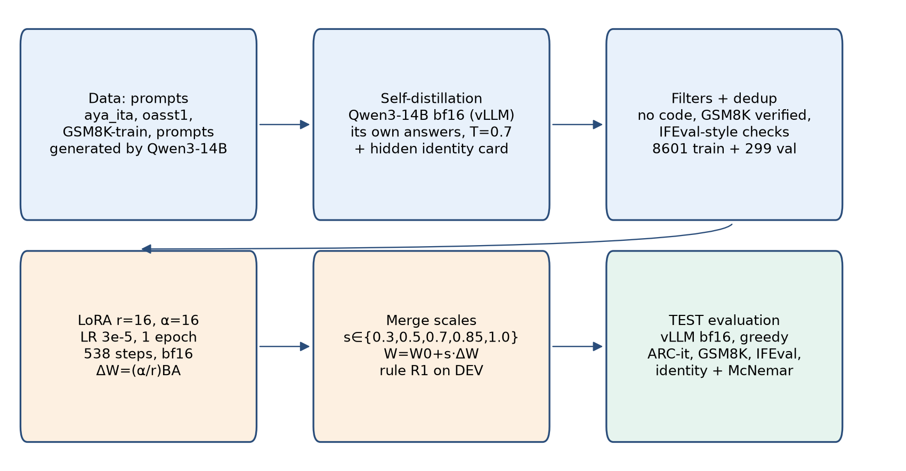
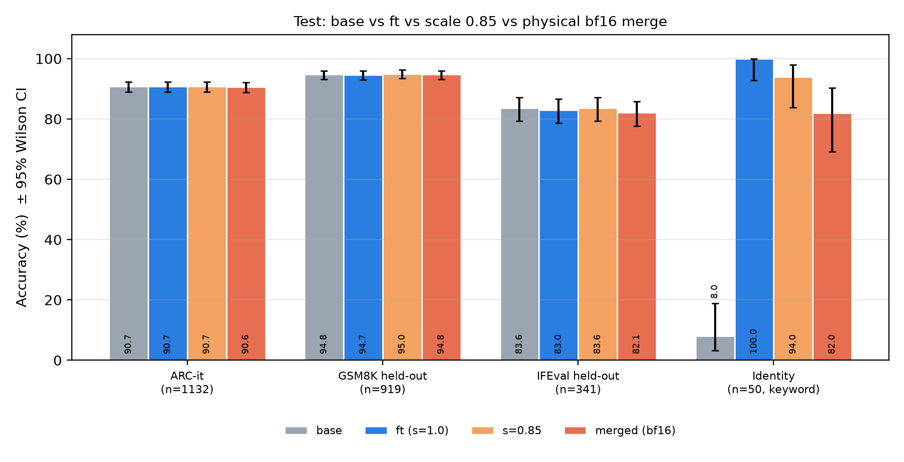

Project *Lo Scienziato Dilettante GDP*, Arianna Labs.

**Cite as:** Del Papa, G. (2026). DOI: [10.5281/zenodo.23757652](https://doi.org/10.5281/zenodo.23757652) · *Versione italiana: `divulgativa_it.pdf`*

**The problem.** An open AI model like Qwen3-14B, if you ask "who are you?", says it is "Qwen, from Alibaba". I wanted a model that knew it was part of the project *Lo Scienziato Dilettante GDP* by Arianna Labs. But there is a risk: in my earlier attempts, teaching a model something new made it *worse* at maths and at following instructions.

**What I did.** Instead of giving it examples written by other AIs, I had **the model itself write the answers** (it is called "self-distillation"): it learns style and identity without changing how it reasons. I used about 8,900 examples, no programming code, and only material whose licence allows commercial use. Then I added a small "layer" of knowledge to the model (called LoRA, 0.4 % of the model), trained for about an hour on a rented graphics card. One important point: **I wrote down the rule for choosing how "strongly" to apply the layer before seeing any result**, and then I followed it.

**What I found.** I ran the exam on questions the model had never seen:

- **Science questions in Italian (1132):** 90.7 % before, 90.7 % after.
- **Maths (919 problems):** 94.8 % before, 94.7 % after.
- **Following instructions (341 prompts):** 83.6 % before, 83.0 % after.
- **"Who are you?" questions (50):** from 4 out of 50 to 50 out of 50 — but see the caveats below.

So **the only thing that clearly improves is identity**. The model is not smarter than before: it just knows who it is.

**How far to trust it (the limits, in short).**

- The identity test looks for **keywords** in the answer (like "Arianna Labs"); no person or other AI judges it. Also, 4 of the "right" answers of the original model were really false positives: the word was already in the question. On the genuine identity questions the original model scored 0.
- The 100 % **does not mean it says true things**: it sometimes invents details I never gave it (for instance "CEO", "entrepreneur", a fictional character), and once it answered in English to an Italian question.
- For maths and instructions we cannot say it did not get slightly worse: the numbers are equal, but the sample is small.
- There was **only one run**. A first attempt ($5.69) was lost through my own mistake; the valid one cost $4.48.
- If you "fuse" the layer permanently into the model (bf16 format) identity drops to 82 %: that is why I publish the layer (adapter), not the fused model.

**The message.** Giving an open model an identity can be done cheaply without ruining it, but "knows who it is" does not mean "always tells the truth" nor "is better". All code, data and results are public, so anyone can check.

Code, data and adapter: huggingface.co/odelpa/qwen14-scienziato-v2 · github.com/usergdp136/qwen14-scienziato-v2
